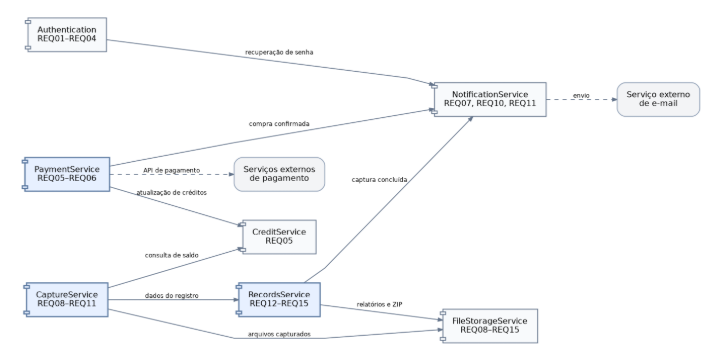
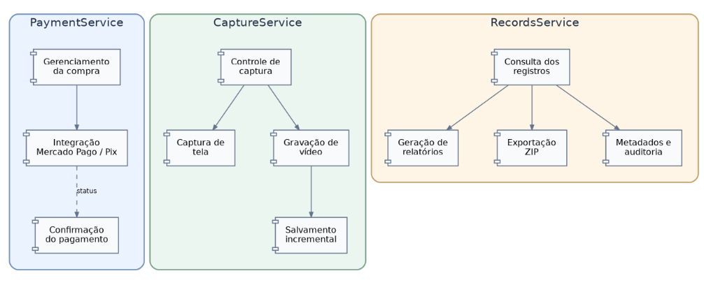

# Componentes Candidatos

A lista de componentes candidatos para o sistema com uma breve descrição das suas responsabilidades de acordo com os requisitos e características arquiteturais.

Com base nos requisitos funcionais e nas características arquiteturais identificadas, foram definidos os seguintes componentes candidatos:

## 1. Authentication

Responsável pelo cadastro, autenticação, recuperação de senha e encerramento de sessões dos usuários (REQ-01 a REQ-04). Também deve controlar o acesso aos recursos do sistema, garantindo que cada usuário possa consultar apenas os registros aos quais possui autorização.

## 2. CreditService

Responsável pelo gerenciamento dos pacotes de créditos, incluindo as opções básico, médio e premium, definidas no documento de requisitos (REQ-05). Deve controlar o saldo disponível para cada usuário e realizar sua atualização após a confirmação de pagamentos, mantendo a consistência dos créditos adquiridos.

## 3. PaymentService

Responsável pelo processamento das compras de créditos (REQ-05 e REQ-06), incluindo os dados de faturamento e a integração com os mecanismos de pagamento. Deve oferecer suporte ao Mercado Pago e aos pagamentos via Pix, além de verificar a confirmação das transações antes de solicitar a atualização do saldo do usuário.

## 4. NotificationService

Responsável pelo envio das notificações por e-mail, incluindo a confirmação de compras (REQ-07), conclusão de gravações (REQ-10) e conclusão de capturas de tela (REQ-11). Esse componente deve ser independente das operações principais, para que uma falha no serviço de e-mail não impeça, por exemplo, a conclusão de um registro.

## 5. CaptureService

Responsável pela captura e gravação do conteúdo de páginas da internet (REQ-08, REQ-09 e REQ-11). Deve controlar o início e a finalização das operações, encaminhar os arquivos produzidos para armazenamento e manter informações sobre o andamento de cada captura. Também deve permitir a preservação do conteúdo já obtido caso ocorra uma interrupção.

## 6. RecordsService

Responsável pelo gerenciamento dos registros realizados pelos usuários (REQ-12 a REQ-15). Deve fornecer a listagem e os detalhes das capturas, gerar relatórios contendo as informações exigidas e organizar a exportação dos arquivos em formato ZIP. Também deve manter os metadados necessários à rastreabilidade dos registros, como identificação do usuário, datas e horários das operações.

## 7. FileStorageService

Responsável pelo armazenamento e recuperação dos arquivos gerados durante as capturas e gravações. Deve preservar a integridade dos conteúdos armazenados e disponibilizá-los para consulta, geração de relatórios e exportação. Também deve oferecer mecanismos que reduzam o risco de perda dos arquivos em caso de falhas.

## Diagrama de Componentes Candidatos

O diagrama apresenta os sete componentes candidatos do Veridt e suas principais dependências, mostrando como as responsabilidades do sistema estão distribuídas. Essa separação permite que funcionalidades como autenticação, pagamentos, capturas e gerenciamento de registros sejam tratadas de maneira relativamente independente, reduzindo o acoplamento entre elas. Além disso, foram especificados três dos sete componentes, escolhidos por concentrarem operações críticas para o funcionamento da aplicação.

## Especificação dos Componentes (30%)

O PaymentService foi detalhado porque envolve transações financeiras e atualização dos créditos dos usuários (REQ-05 e REQ-06), sendo necessário distinguir o processamento da compra da confirmação do pagamento. O CaptureService, por sua vez, é responsável pela principal funcionalidade do sistema, a obtenção de evidências (REQ-08, REQ-09 e REQ-11). Por isso, foram separados o controle da captura, a obtenção de imagens e a gravação de vídeos e o salvamento incremental, que contribui para a preservação do conteúdo em caso de falhas. Já o RecordsService foi escolhido por concentrar a consulta dos registros, a geração de relatórios e a exportação dos arquivos (REQ-12 a REQ-15). Seu detalhamento também considera a rastreabilidade e a auditabilidade, características importantes para que seja possível relacionar as evidências às operações que as originaram.
